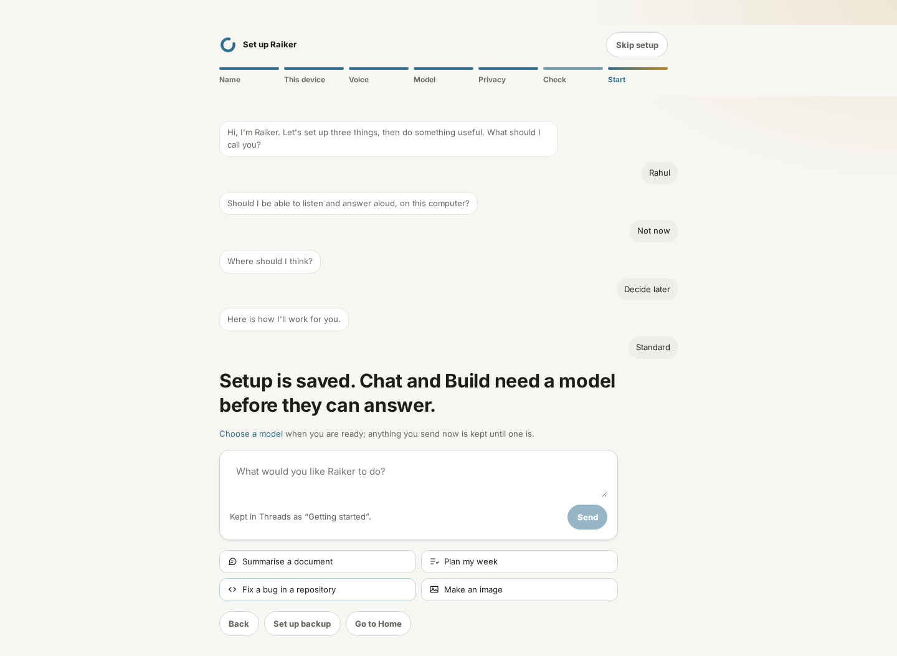

# Linux beta hardening and qualification — 2026-11-09

This continues the installed Linux test-candidate run. The host is Ubuntu
24.04 x86-64 in Codespaces (2 processors, 8 GiB RAM). These measurements do
not constitute beta sign-off. Existing owner decisions about beta.2, signing,
fresh VMs and hardware remain in force.

## Work and evidence

| Requested work | Result and limit |
|---|---|
| RPM and all-format packaging | Reproduced FPM's `rpmbuild failed (exit code )` using its default `w9T.xzdio`, peaking above 1.9 GiB RSS. A controlled 512 MiB address-space test fails with that compressor and succeeds with `w6.xzdio`. RPM now explicitly uses single-threaded level-6 xz. The original signal is not identified, so memory exhaustion is an inference, not a proved historical OOM. The fresh Python 3.12 freeze, smoke checks and full AppImage/DEB/RPM wrapper passed. All three SHA-256 checks pass; RPM reports xz level 6 and its payload digests verify. RPM native Fedora installation remains untested. |
| Disposable Apply | Linux Apply pins both trees' parent directories with `O_DIRECTORY | O_NOFOLLOW` until Apply/rollback completes. Reads pin the leaf once and reject nonregular files. Atomic rollback replaces directory entries instead of truncating a possible link referent. Six deterministic adversarial tests cover parent swaps on both sides, symlink/hardlink substitution during rollback, FIFO substitution and persistent ENOSPC. **Windows/macOS handles and the file-tool TaskTree path race remain open.** |
| Managed Voice V1 | Five Whisper model files now have immutable Hugging Face revisions, exact sizes and LFS SHA-256 digests. Amy has a digest but remains refused for licence review. Linux/macOS whisper-server assets, packaged speech execution and Kokoro's GPL-related dependency review remain blockers; VD-1 stays partial. |
| Seven journeys | First-run setup and keyboard/zoom UI checks ran, with screenshots inspected. The updated first-run spec explicitly defers Voice. These are partial T-01/T-14 evidence; the seven full journeys and five fresh-state model-driven repetitions are **not** declared passed. See the journey table below. |
| Fault injection | Actual storage exhaustion on a dedicated 16 MiB tmpfs filled to 98.02%; Apply retained its journal and recovered the originals once space returned. A live host was killed mid-goal and restarted: same task, one model call, `interrupted_by_restart`, no false completion. Provider socket faults and native resource-limit tests passed. |
| Integration lifecycle | 39 automated expiry, rejected refresh, vault/removal and connector lifecycle tests passed. They use controlled provider responses. Live provider revocation and the full supported-connector install/use/revoke/remove/reconnect matrix remain blocked by unavailable registered clients/accounts. |
| Egress audit | A timed metadata trace of the installed host found unsolicited startup threat-feed downloads. Fresh profiles now require an owner-requested feed update or explicit `RAIKER_THREAT_FEEDS=on` before background downloads. The corrected-source trace spans 1,805.76 seconds, but its conservative verifier verdict is **not approved**: its connection-activity span is only 181 seconds and the full navigation sweep still reached external destinations. This remains an open gate, separate from the corrected startup regression. |
| Release documentation | This record reconciles the beta plan, open defects, fixed items and acceptance matrix; no platform or owner-machine gate is closed from a different test. |
| Candidate artifacts | The exact-commit GitHub gate, signed artifacts, generated evidence, hashes, provenance and owner sign-off must be checked together. An unsigned local `0.0.0` build and passing source-tree tests do not substitute for that gate. |

Local evidence is retained under `output/linux-beta/` (ignored build output):

| Receipt | What actually passed |
|---|---|
| `rpm-before.log`, `rpm-compression-pressure.json` | Original failure reproduced; bounded-compression comparison |
| `apply-privacy.xml` | 36 Apply, journal/crash-recovery and reputation tests |
| `storage-exhaustion.json`, `storage-exhaustion-live.xml` | Real bounded ENOSPC, journal retained, originals restored |
| `journey-fault-regressions.xml` | 99 memory-forget, stop/control, socket-provider faults, privacy/recovery and connector regressions |
| `goal-restart-current.json` | Real kill/restart, scripted model only; one call before and after, same task ID |
| `linux-native-adversarial.log` | 15 native Linux tests, including memory, CPU and process limits, descendant containment and filtered egress |
| `voice-v1.xml`, `voice-pins.txt` | 23 voice tests and the revision/digest resolution log; no live packaged speech claim |
| `local-inference.xml`, `local-inference.log` | Real verified llama.cpp b12223 CPU install, tiny GGUF inference, second slot, reconfiguration, restart and shutdown |
| `integration-lifecycle.xml` | 39 automated connector lifecycle tests; not live provider sign-in/revocation |
| `release-contracts.xml` | 66 release-evidence, workflow, desktop and documentation contracts |
| `web-components.log` | 39 setup and Web access component tests |
| `web-check.log`, `ruff.txt`, `mypy.txt` | Svelte: zero errors/warnings; Ruff passed; mypy: 631 source files |
| `journeys-corrected-ui.log`, `accessibility-corrected-ui.log` | Onboarding 1/1; keyboard destination sweep and 200% zoom 2/2 |

## Journey qualification

| Journey | This run | Still required for acceptance |
|---|---|---|
| T-01 | Source-host first-run wizard passed, including Voice → Not now and truthful model-deferred state | Fresh installed candidate, permitted useful model and first-task receipt |
| T-03 | Actual host restart drill passed with a scripted model | Calendar/preferences/draft itinerary scenario with a real model, repeated on fresh state |
| T-04 | Forget/suppression regressions passed | Correction/forget/repeated relevant task in the installed UI with real inference and receipts |
| T-08 | Authorized `sharRahul/raiker-test-sandbox` returns 404 to this session; previous creation attempt returned 403 | Repository access, actual bug/branch/check/push/draft-PR receipt; no merge |
| T-13 | Stop, control and provider-fault regressions passed | Real goal with children/pending effects, resume revalidation, and time/cost pause receipts |
| T-14 | Keyboard traversal and 200% zoom passed; screenshots inspected | Screen reader and three first-time evaluators; complete start/approve/stop/find/recover scenario |
| T-15 | Native adversarial, privacy/recovery, provider socket faults and actual storage exhaustion passed | Full hostile-content/expired-provider/duplicate-trigger journey on the installed exact candidate |

Tiny `stories260K` inference verifies the engine lifecycle, not a useful
tool-using assistant. It cannot be used to close the seven journeys.

## Voice licence and distribution review

Whisper models are pinned to
`ggerganov/whisper.cpp@5359861c739e955e79d9a303bcbc70fb988958b1`, under
the existing MIT catalogue classification. The installer still verifies the
actual downloaded bytes; resolving an LFS object ID does not execute a model.

Amy is pinned to
`rhasspy/piper-voices@e7229f7d33a10e145e109b886d661984201ac3c4` but is
**not approved**. Its [upstream model card](https://huggingface.co/rhasspy/piper-voices/blob/e7229f7d33a10e145e109b886d661984201ac3c4/en/en_US/amy/medium/MODEL_CARD)
points to Mimic3 for dataset terms and states Lessac fine-tuning provenance.
The engine's MIT licence does not establish the voice/dataset's terms.
The separate Piper JSON sidecar also needs a pinned digest and verified
installation before enabling this voice; the existing ONNX entry alone is
insufficient. Kokoro's `espeak-ng` distribution review stays open under
[the licensing policy](../licensing/LICENSING_POLICY.md).

## Egress findings and interpretation

The installed pre-fix host's startup thread contacted URLhaus and OpenPhish
before owner setup. This was public-feed retrieval, not evidence that private
content was uploaded, but it contradicts an unconditional local-only traffic
claim. The correction preserves local matching and existing cached lists.
After the first owner-requested update, stale feeds can refresh at startup;
`RAIKER_THREAT_FEEDS=off` still disables background refresh.

Use `scripts/strace_egress_metadata.py` to extract only timestamps and IP
destinations from a private `strace -f -ttt -s 0` network trace, then pass that
JSONL to `scripts/verify_egress_audit.py`. The converter retains failed attempts
and never invents start/end observations. A route-discovery UDP `connect`
does not itself prove a transmitted packet. Native probes also deliberately
contact a listener on the host's own non-loopback address; distinguish those
controls in the record rather than silently dropping them or adding arbitrary
external hosts to the release allowlist.

## Visual evidence

These are **source-host** screenshots, taken with a changed working tree over
`304e71ff`; they are not presented as frozen-candidate screenshots. Original
capture metadata is retained beside them as `source-manifest.json`.

## Reference decisions

The package change follows RPM's documented [payload compression flags](https://rpm.org/docs/latest/man/rpm-payloadflags.7).
The containment review also consulted [Claude Code's filesystem/network sandbox guidance](https://code.claude.com/docs/en/sandboxing)
and [Hermes Agent's security boundary documentation](https://github.com/NousResearch/hermes-agent/blob/main/SECURITY.md).
These references inform implementation review; none supplies Raiker's test
evidence, licences, sign-off or authorization to widen beta scope.

## Artifact and audit receipts

The new local all-format artifacts are unsigned `0.0.0` test builds from this
working tree, collected under `output/linux-beta/packages-hardened/`. They do
not carry an exact-commit provenance claim. Their
[checksums](evidence/linux-beta-2026-11-09/SHA256SUMS-linux-x86_64.txt),
[compression-pressure result](evidence/linux-beta-2026-11-09/rpm-compression-pressure.json),
[real storage-pressure receipt](evidence/linux-beta-2026-11-09/storage-exhaustion.json)
and [goal restart receipt](evidence/linux-beta-2026-11-09/goal-restart.json)
are retained with this record.

Both timed network recordings are retained privately under `output/` and
contain no captured payloads. The [installed pre-fix verdict](evidence/linux-beta-2026-11-09/egress-installed-before.json)
and [corrected-source verdict](evidence/linux-beta-2026-11-09/egress-source-corrected.json)
are **not approved**. The latter trace's first/last recorded syscall events
span 1,805.76 seconds, but the existing verifier measures first/last connection
activity (181 seconds), which cannot qualify its idle tail. Do not fabricate
connection observations to fill that gap. In addition to documented local
probe/route-discovery destinations, the navigation sweep observed external
addresses still requiring attribution and an explicit local-only policy.
The corrected startup guard alone does not close MM-5.
