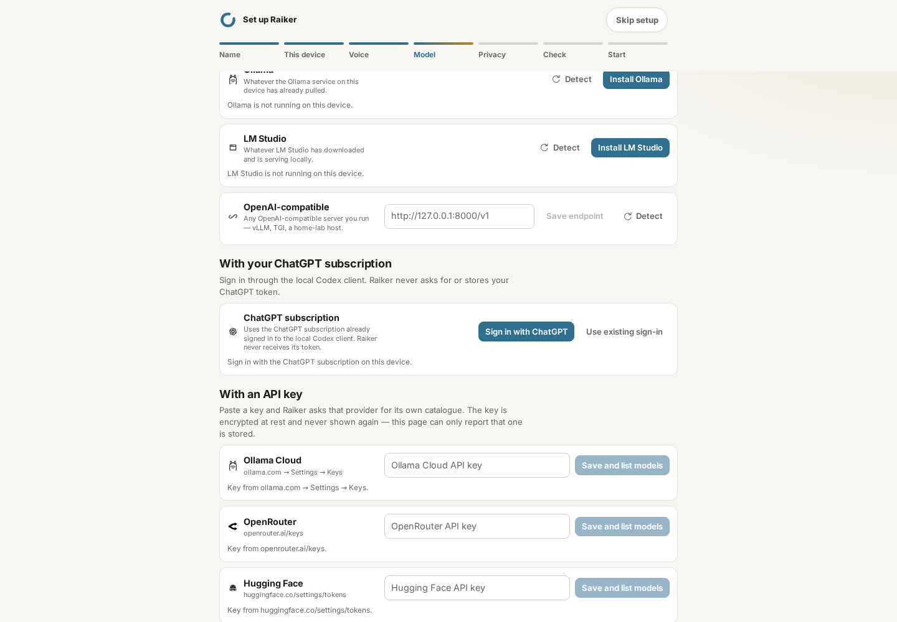
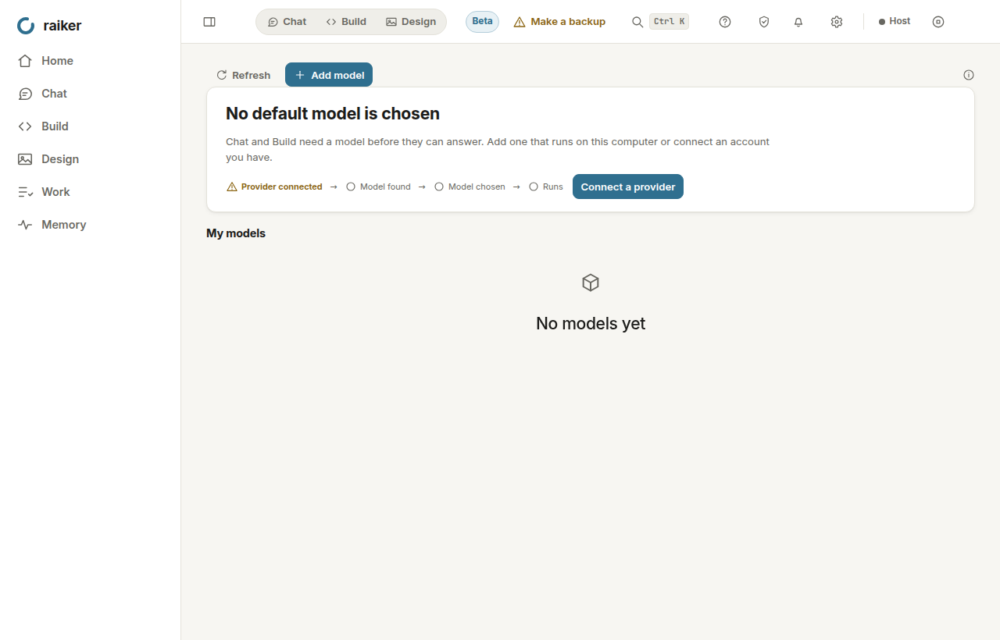
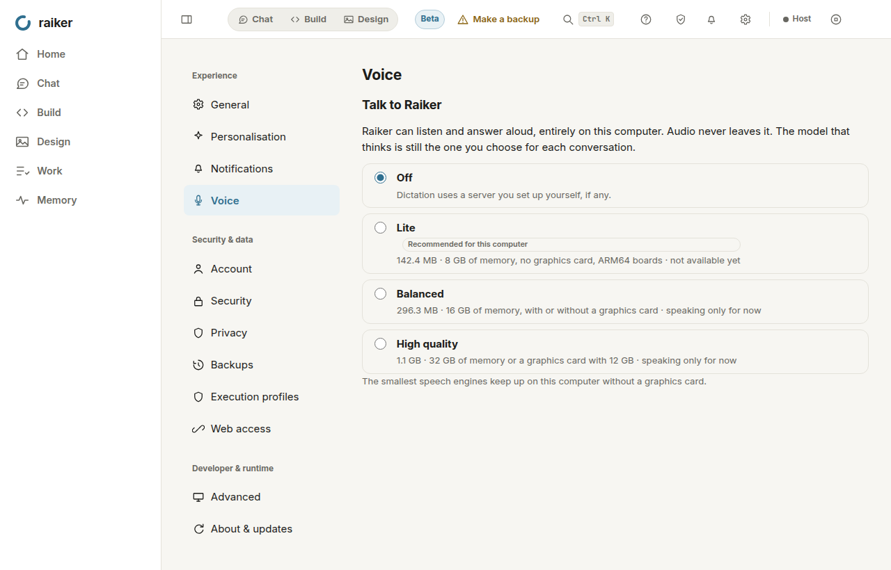
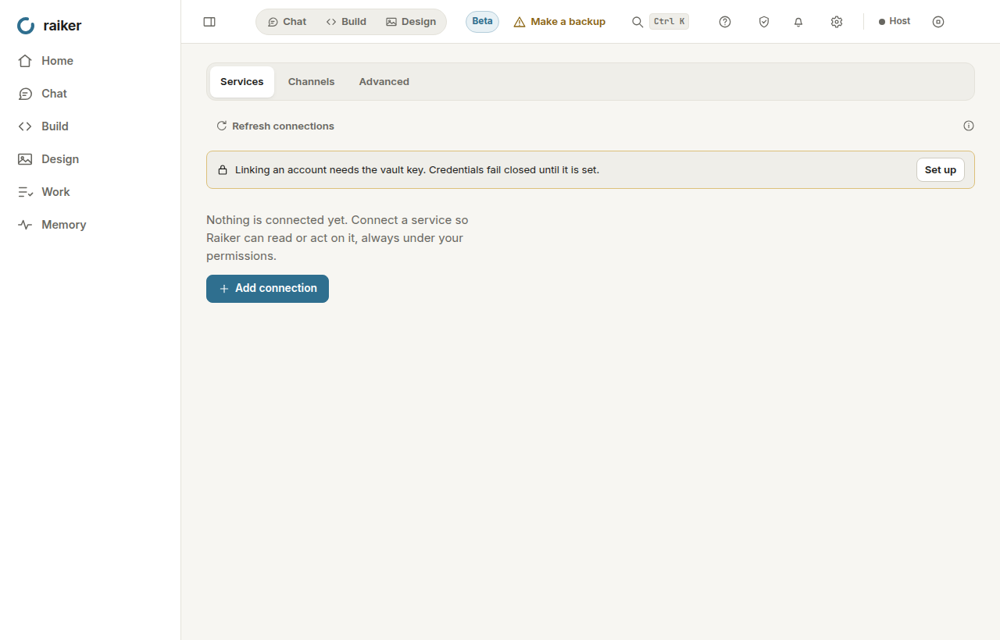

# Linux beta hardening and qualification — 2026-11-09

> Owner scope update: personal use for at most five users, PC first and
> phone/iPad later; no commercial-grade distribution/signing prerequisite.
> Piper is removed in favor of Kokoro-82M. The earlier `6c211b60` signed
> candidate/audit precede this change and retain their original SHA.
> [Authoritative scope and remaining engineering checks](PERSONAL_BETA_SCOPE.md).


This continues the installed Linux test-candidate run. The host is Ubuntu
24.04 x86-64 in Codespaces (2 processors, 8 GiB RAM). These measurements do
not constitute beta sign-off. Existing owner decisions about beta.2, signing,
fresh VMs and hardware remain in force.

## Work and evidence

| Requested work | Result and limit |
|---|---|
| RPM and all-format packaging | Reproduced FPM's `rpmbuild failed (exit code )` using its default `w9T.xzdio`, peaking above 1.9 GiB RSS. A controlled 512 MiB address-space test fails with that compressor and succeeds with `w6.xzdio`. RPM now explicitly uses single-threaded level-6 xz. The original signal is not identified, so memory exhaustion is an inference, not a proved historical OOM. The fresh Python 3.12 freeze, smoke checks and full AppImage/DEB/RPM wrapper passed. All three SHA-256 checks pass; RPM reports xz level 6 and its payload digests verify. RPM native Fedora installation remains untested. |
| Disposable Apply | Linux Apply pins both trees' parent directories with `O_DIRECTORY | O_NOFOLLOW` until Apply/rollback completes. Reads pin the leaf once and reject nonregular files. Atomic rollback replaces directory entries instead of truncating a possible link referent. Six deterministic adversarial tests cover parent swaps on both sides, symlink/hardlink substitution during rollback, FIFO substitution and persistent ENOSPC. **Windows/macOS handles and the file-tool TaskTree path race remain open.** |
| Managed Voice V1 | Five Whisper model files now have immutable Hugging Face revisions, exact sizes and LFS SHA-256 digests. Amy has a digest but remains refused for licence review. Linux/macOS whisper-server assets, packaged speech execution and Kokoro's GPL-related dependency review remain blockers; VD-1 stays partial. |
| Seven journeys | First-run setup and keyboard/zoom UI checks ran, with screenshots inspected. The updated first-run spec explicitly defers Voice. These are partial T-01/T-14 evidence; the seven full journeys and five fresh-state model-driven repetitions are **not** declared passed. See the journey table below. |
| Fault injection | Actual storage exhaustion on a dedicated 16 MiB tmpfs filled to 98.02%; Apply retained its journal and recovered the originals once space returned. A live host was killed mid-goal and restarted: same task, one model call, `interrupted_by_restart`, no false completion. Provider socket faults and native resource-limit tests passed. |
| Integration lifecycle | 39 automated expiry, rejected refresh, vault/removal and connector lifecycle tests passed. They use controlled provider responses. Live provider revocation and the full supported-connector install/use/revoke/remove/reconnect matrix remain blocked by unavailable registered clients/accounts. |
| Egress audit | The fresh installed `6c211b60` shell/host capture passes its predeclared scope: 1,862 seconds of observed activity, 4,115 observations, no unexpected destinations. All 135 Chromium IPv6 UDP route probes fail with ENETUNREACH and close without same-thread sends. Earlier failed traces remain failed. This unsigned, credential-free navigation profile does **not** close the all-feature signed-candidate MM-5 gate. |
| Release documentation | This record reconciles the beta plan, open defects, fixed items and acceptance matrix; no platform or owner-machine gate is closed from a different test. |
| Candidate artifacts | Release `42650624663` produced non-published `0.9.0` beta artifacts from exact runtime commit `6c211b60`. All 10 installer hashes/Ed25519 manifests, six Linux GPG signatures, signed channel/provenance, SBOM binding and lock/checksum files independently verify against repository pins. The product verifier passes. macOS platform signing remains excepted; feature/journey/owner sign-off gates remain open. |

Local evidence is retained under `output/linux-beta/` (ignored build output):

| Receipt | What actually passed |
|---|---|
| `rpm-before.log`, `rpm-compression-pressure.json` | Original failure reproduced; bounded-compression comparison |
| `apply-privacy.xml` | 36 Apply, journal/crash-recovery and reputation tests |
| `storage-exhaustion.json`, `storage-exhaustion-live.xml` | Real bounded ENOSPC, journal retained, originals restored |
| `journey-fault-regressions.xml` | 99 memory-forget, stop/control, socket-provider faults, privacy/recovery and connector regressions |
| `goal-restart-current.json` | Real kill/restart, scripted model only; one call before and after, same task ID |
| `linux-native-adversarial.log` | 15 native Linux tests, including memory, CPU and process limits, descendant containment and filtered egress |
| `voice-v1.xml`, `voice-pins.txt` | 23 voice tests and the revision/digest resolution log; no live packaged speech claim |
| `local-inference.xml`, `local-inference.log` | Real verified llama.cpp b12223 CPU install, tiny GGUF inference, second slot, reconfiguration, restart and shutdown |
| `integration-lifecycle.xml` | 39 automated connector lifecycle tests; not live provider sign-in/revocation |
| `release-contracts.xml` | 66 release-evidence, workflow, desktop and documentation contracts |
| `web-components.log` | 39 setup and Web access component tests |
| `web-check.log`, `ruff.txt`, `mypy.txt` | Svelte: zero errors/warnings; Ruff passed; mypy: 631 source files |
| `journeys-corrected-ui.log`, `accessibility-corrected-ui.log` | Onboarding 1/1; keyboard destination sweep and 200% zoom 2/2 |

## Journey qualification

| Journey | This run | Still required for acceptance |
|---|---|---|
| T-01 | Source-host first-run wizard passed, including Voice → Not now and truthful model-deferred state | Fresh installed candidate, permitted useful model and first-task receipt |
| T-03 | Actual host restart drill passed with a scripted model | Calendar/preferences/draft itinerary scenario with a real model, repeated on fresh state |
| T-04 | Forget/suppression regressions passed | Correction/forget/repeated relevant task in the installed UI with real inference and receipts |
| T-08 | Authorized `sharRahul/raiker-test-sandbox` returns 404 to this session; previous creation attempt returned 403 | Repository access, actual bug/branch/check/push/draft-PR receipt; no merge |
| T-13 | Stop, control and provider-fault regressions passed | Real goal with children/pending effects, resume revalidation, and time/cost pause receipts |
| T-14 | Keyboard traversal and 200% zoom passed; screenshots inspected | Screen reader and three first-time evaluators; complete start/approve/stop/find/recover scenario |
| T-15 | Native adversarial, privacy/recovery, provider socket faults and actual storage exhaustion passed | Full hostile-content/expired-provider/duplicate-trigger journey on the installed exact candidate |

Tiny `stories260K` inference verifies the engine lifecycle, not a useful
tool-using assistant. It cannot be used to close the seven journeys.

## Voice licence and distribution review

Whisper models are pinned to
`ggerganov/whisper.cpp@5359861c739e955e79d9a303bcbc70fb988958b1`, under
the existing MIT catalogue classification. The installer still verifies the
actual downloaded bytes; resolving an LFS object ID does not execute a model.

Amy is pinned to
`rhasspy/piper-voices@e7229f7d33a10e145e109b886d661984201ac3c4` but is
**not approved**. Its [upstream model card](https://huggingface.co/rhasspy/piper-voices/blob/e7229f7d33a10e145e109b886d661984201ac3c4/en/en_US/amy/medium/MODEL_CARD)
points to Mimic3 for dataset terms and states Lessac fine-tuning provenance.
The engine's MIT licence does not establish the voice/dataset's terms.
The separate Piper JSON sidecar also needs a pinned digest and verified
installation before enabling this voice; the existing ONNX entry alone is
insufficient. Kokoro's `espeak-ng` distribution review stays open under
[the licensing policy](../licensing/LICENSING_POLICY.md).

## Egress findings and interpretation

The installed pre-fix host's startup thread contacted URLhaus and OpenPhish
before owner setup. This was public-feed retrieval, not evidence that private
content was uploaded, but it contradicts an unconditional local-only traffic
claim. The correction preserves local matching and existing cached lists.
After the first owner-requested update, stale feeds can refresh at startup;
`RAIKER_THREAT_FEEDS=off` still disables background refresh.

Use `scripts/strace_egress_metadata.py` to extract only timestamps and IP
destinations from a private `strace -f -ttt -s 0` network trace, then pass that
JSONL to `scripts/verify_egress_audit.py`. The converter retains failed attempts
and never invents start/end observations. A route-discovery UDP `connect`
does not itself prove a transmitted packet. Native probes also deliberately
contact a listener on the host's own non-loopback address; distinguish those
controls in the record rather than silently dropping them or adding arbitrary
external hosts to the release allowlist.

## Visual evidence

These are **source-host** screenshots, taken with a changed working tree over
`304e71ff`; they are not presented as frozen-candidate screenshots. Original
capture metadata is retained beside them as `source-manifest.json`.


## Reference decisions

The package change follows RPM's documented [payload compression flags](https://rpm.org/docs/latest/man/rpm-payloadflags.7).
The containment review also consulted [Claude Code's filesystem/network sandbox guidance](https://code.claude.com/docs/en/sandboxing)
and [Hermes Agent's security boundary documentation](https://github.com/NousResearch/hermes-agent/blob/main/SECURITY.md).
These references inform implementation review; none supplies Raiker's test
evidence, licences, sign-off or authorization to widen beta scope.

## Artifact and audit receipts

The new local all-format artifacts are unsigned `0.0.0` test builds from this
working tree, collected under `output/linux-beta/packages-hardened/`. They do
not carry an exact-commit provenance claim. Their
[checksums](evidence/linux-beta-2026-11-09/SHA256SUMS-linux-x86_64.txt),
[compression-pressure result](evidence/linux-beta-2026-11-09/rpm-compression-pressure.json),
[real storage-pressure receipt](evidence/linux-beta-2026-11-09/storage-exhaustion.json)
and [goal restart receipt](evidence/linux-beta-2026-11-09/goal-restart.json)
are retained with this record.

Both timed network recordings are retained privately under `output/` and
contain no captured payloads. The [installed pre-fix verdict](evidence/linux-beta-2026-11-09/egress-installed-before.json)
and [corrected-source verdict](evidence/linux-beta-2026-11-09/egress-source-corrected.json)
are **not approved**. The latter trace's first/last recorded syscall events
span 1,805.76 seconds, but the existing verifier measures first/last connection
activity (181 seconds), which cannot qualify its idle tail. Do not fabricate
connection observations to fill that gap. In addition to documented local
probe/route-discovery destinations, the navigation sweep observed external
addresses still requiring attribution and an explicit local-only policy.
The corrected startup guard alone does not close MM-5.

## Sidecar status and RPM payload follow-through

The navigation sweep also exercised ChatGPT subscription status, which started
the installed Codex App Server before this Raiker profile had connected it.
FIXED-1375 makes an unconnected status read passive (`not_connected`) and
retains explicit sign-in/adoption. This corrects another unsolicited-network
path; it does not retroactively approve either failed capture or establish
that every external address in them came from this process. Local evidence:
`passive-codex.xml` (22 tests), `codex-contracts-locked.log` (5 contract cases),
`passive-codex-mypy.txt` and `passive-codex-web-check-final.log`. API generation
was verified under the locked Python 3.12 build environment; the workspace's
Python 3.14 renders some existing optional-union inventory names differently.

The RPM's extracted host passed the full smoke/restart/setup-persistence suite
(`rpm-host-smoke.txt`). Its onboarding window passed. The separate first-run
window test initially observed a renderer crash during Setup; its isolated
fresh-profile retry passed (`rpm-window-retry.log`). Both attempts are retained.
A retry does not erase the initial crash; native Fedora installation and a
repeatability check remain outside this Ubuntu extraction test.

## GitHub qualification and release-dispatch access

Runtime commit `8a053a907b9c9e97bef4163f479650ac3d652f28` is pushed to main.
[CI](https://github.com/sharRahul/Raiker/actions/runs/42639300007),
[llama.cpp engine](https://github.com/sharRahul/Raiker/actions/runs/42639300373)
and [Data safety drills](https://github.com/sharRahul/Raiker/actions/runs/42639300064)
are all green, including Ruff, mypy, lint/type checking, every Python shard,
security/dependency checks and real inference on all three operating systems.
The exact verification script from Release → Plan also passed locally for
that SHA ([receipt](evidence/linux-beta-2026-11-09/exact-release-gate-8a053a90.json)).
The previous runtime/packaging commit `91b07ce2` additionally passed all desktop
targets and the Windows-on-Arm emulated installation in
[Desktop package](https://github.com/sharRahul/Raiker/actions/runs/42637512116).
That packaging evidence is explicitly not an exact-`8a053a90` package claim.

The signed, non-published release dispatch was attempted with version `0.9.0`,
channel `beta`, signing `require-except-macos`, and `publish=false`. GitHub
rejected it: **403 Resource not accessible by integration**. No release run or
new signed artifacts were created by that attempt. Actions write access or an
owner-triggered manual run is required; do not change the workflow's deliberate
manual trigger or weaken its gate to bypass this permission boundary.

Once access is available, the concrete non-publishing command is:

```bash
gh workflow run release.yml --ref main \
  -f version=0.9.0 -f channel=beta -f signing=require-except-macos \
  -F publish=false
```

Recheck every required result on the SHA selected by that run. Signed channel,
SBOM, provenance and `RELEASE_EVIDENCE.md` must come from its actual outputs;
they remain blocked here. An unsigned local candidate cannot substitute for
those trust records. Publication remains blocked by the feature/journey/audit
gates independently of workflow access.

The final source UI status check returned `not_connected`, kept the explicit
adoption button visible, and observed no public destinations in its focused
trace ([UI receipt](evidence/linux-beta-2026-11-09/passive-status-ui-8a053a90.json),
[network receipt](evidence/linux-beta-2026-11-09/passive-status-network-8a053a90.json)).
It is a short regression check, not MM-5 acceptance.



## Electron network process follow-through

The unsigned exact-commit `0.9.0` candidate from
`2f0ede1d8d09efe93458369d278dfdbc70d76120` built in all three formats;
checksums, installed DEB host smoke/restart/setup persistence and local SPDX
generation passed (`candidate-2f0ede1d/`, `candidate-installed-smoke.txt`,
`candidate-sbom.log`). It is unsigned and is not an approved release.

A new installed-shell capture includes Electron and its child host, rather
than only the host. Its startup network process attempted public IPv4 Google
connections before owner setup. FIXED-1376 disables automatic DoH before the
default session exists, suppresses external hostname resolution and cancels
non-loopback renderer HTTP(S)/websocket resource requests. The local host and
explicit external-browser actions keep their respective roles.

Validation: 36 desktop unit tests and 13 shell UI tests passed. The new
embedded-resource test first reaches its server outside the shell, then proves
the renderer request is blocked before it reaches that server. The corrected
focused startup trace has no corresponding public IPv4 connections;
[its raw destination report](evidence/linux-beta-2026-11-09/electron-network-focused.json)
retains `2001:4860:4860::8888`. This is **not claimed as zero public-address
syscalls**: a separate socket/close trace shows a UDP socket whose connect
fails with ENETUNREACH and closes without a DNS payload. Chromium documents
that literal address as its [IPv6 route/reachability heuristic](https://chromium.googlesource.com/chromium/src/+/refs/heads/main/net/dns/README.md#IPv6-and-connectivity).
Do not equate that non-sending route probe with a completed DoH request, or
silently omit it from the conservative audit input.

Implementation follows Electron's [resolver API](https://www.electronjs.org/docs/latest/api/app#appconfigurehostresolveroptions)
and Chromium's [host-resolution remapping](https://chromium.googlesource.com/chromium/src/+/refs/heads/main/net/dns/README.md#Request-remapping).
A short startup regression is not a replacement for a fresh 30-minute
installed-candidate audit. The pre-fix full-shell trace remains failed.

The owner started [Release 42642643448](https://github.com/sharRahul/Raiker/actions/runs/42642643448)
on `2f0ede1d`. Plan correctly refused because that commit's CI had not yet
finished; packaging/signing did not start. Its macOS native job was cancelled
while queued, then the failed-job rerun completed successfully: CI, engine/live
and data-safety workflows on `2f0ede1d` are green. The shell correction changes
the candidate source again: qualify its own commit and start a new Release run
for that commit rather than treating the older run as evidence for the fix.

## Completed installed-shell audit and CI artifact verification

Runtime commit: `6c211b605d3c42d77215ff69cbed3f346c95d685`.
[CI](https://github.com/sharRahul/Raiker/actions/runs/42646385241),
[data safety](https://github.com/sharRahul/Raiker/actions/runs/42646385452),
[engine/live inference](https://github.com/sharRahul/Raiker/actions/runs/42646385237)
and the complete [desktop matrix](https://github.com/sharRahul/Raiker/actions/runs/42646385236)
are green. The macOS live-inference job was cancelled before starting; its
failed-job rerun passed. The [exact Release Plan gate](evidence/linux-beta-2026-11-09/release-gate-6c211b60.txt)
passed on this same commit. [Workflow receipt](evidence/linux-beta-2026-11-09/workflow-checks-6c211b60.json).

The downloaded unsigned CI `0.0.0` Linux artifacts all match their recorded
hashes and sizes; RPM reports `xz 6` and passes its payload digests.
Installed DEB and AppImage smoke/restart/setup persistence, packaged onboarding
and uninstall-with-data-retention passed on GitHub's Linux runner.
[Artifact verification](evidence/linux-beta-2026-11-09/ci-linux-verification-6c211b60.json).
The separate local unsigned `0.9.0` candidate also passed hash checks, installed
host smoke and SPDX/licence inventory. Its extracted AppImage payload passed
first launch (one test); this is not a claim of native FUSE mounting here.

The final installed-shell audit used that local unsigned `0.9.0` DEB. Its
[scope](evidence/linux-beta-2026-11-09/installed-shell-6c211b60-scope.json)
was recorded before capture: fresh synthetic owner, no model selected, Voice
off, no connected external services. Electron and its frozen-host descendants
were traced with payloads elided. The driver completed 62 page visits over
30 minutes and recorded no navigation failures.
[UI receipt](evidence/linux-beta-2026-11-09/installed-shell-6c211b60-ui-receipt.json).
The recorder was stopped after that exercise, before its 33-minute safety timeout.

The unchanged verifier approved **1,862 seconds** of actual destination activity,
**4,115 observations**, and **zero unexpected hosts** against that scope.
[Verifier report](evidence/linux-beta-2026-11-09/installed-shell-6c211b60-verifier-report.json).
The source metadata capture SHA-256 is
`1bb8fb59ae41f2b27dc6fa45a5af088c38875c3a06575a02d6de37f5222b15ba`.
[Capture/trace hashes and limits](evidence/linux-beta-2026-11-09/installed-shell-6c211b60-capture-receipt.json).
The private trace and JSONL remain in ignored `output/linux-beta/egress-shell-hardened/`;
only redacted receipts are committed.

The predeclared exceptions include this machine's native sandbox/control
probes and Chromium's literal IPv6 route heuristic. All **135** Chromium
observations use UDP, fail with ENETUNREACH, and close without a send on the
same thread before close.
[Probe receipt](evidence/linux-beta-2026-11-09/installed-shell-6c211b60-route-probes.json).
This is not a zero-public-address-syscall claim. The earlier threat-feed,
ChatGPT sidecar and Electron public-request failures are retained in the
historical receipts; no destinations or timestamps were removed to obtain approval.

**MM-5 stays partial:** this credential-free navigation profile does not cover
useful-model inference, installed managed speech, enabled connectors, full
owner-machine canary/recovery evidence or a fresh audit of the signed artifact.
The seven journeys and owner sign-off remain open. Inspected screenshots:





## Verified non-published signed candidate

The owner started [Release 42650624663](https://github.com/sharRahul/Raiker/actions/runs/42650624663)
with version **`0.9.0`**, channel **`beta`**, signing **`require-except-macos`**,
and **`publish=false`**. Plan's exact-commit gate passed on runtime
`6c211b605d3c42d77215ff69cbed3f346c95d685`; every native packaging job,
Windows ARM emulation, matrix and channel job passed. Publication jobs were
skipped. The earlier `0.9.0-beta1` attempt was correctly refused by the updater's
X.Y.Z version rule; it produced no candidate. The successful run supersedes
the Actions-dispatch blocker for **this candidate** through the owner's manual
start, without changing the session's dispatch permissions.

Download the [release-channel artifact](https://github.com/sharRahul/Raiker/actions/runs/42650624663/artifacts/13690398721)
(30-day workflow retention). A local copy is retained in ignored
`output/linux-beta/release-channel-6c211b60/`.

Independent verification used the repository-pinned Ed25519 key and an isolated
GPG keyring imported from the repository's pinned Linux public key:

- All **10** installer manifest signatures and artifact SHA-256 hashes pass.
- All **six Linux** detached GPG signatures match fingerprint
  `248BC52909AAAAFDFA77EF0D0BFFAD3B8A2024C1`.
- Channel and provenance signatures pass against the pinned Ed25519 key;
  the published public key matches that pin.
- Provenance names exact runtime `6c211b60` and this workflow; its `uv.lock`
  hash matches the repository. SBOM and artifact digests and every checksum
  file verify.
- The product's own release verifier passes using the repository pin.
- The generated `RELEASE_EVIDENCE.md` names the correct commit and contains
  no missing-output marker.

[Verification receipt](evidence/linux-beta-2026-11-09/release-candidate-verification-6c211b60.json),
[workflow results](evidence/linux-beta-2026-11-09/release-workflow-42650624663.json),
[product verification](evidence/linux-beta-2026-11-09/release-product-verification.log),
[generated release evidence](evidence/linux-beta-2026-11-09/RELEASE_EVIDENCE-6c211b60.md),
and [signed provenance](evidence/linux-beta-2026-11-09/release-provenance-6c211b60.json)
([detached signature](evidence/linux-beta-2026-11-09/release-provenance-6c211b60.json.sig)).
Windows Authenticode identity and native installation were checked on Windows
by the workflow, not independently executed on Linux. macOS remains unsigned
at the platform level under the existing beta exception; its Ed25519 manifests
still verify. No GitHub release or publication is claimed from this run.

The reporting correction (FIXED-1377) does not change that candidate. The
owner subsequently requested Piper removal and a personal Kokoro build; that
runtime change needs its own candidate. These earlier signed outputs remain
exactly `6c211b60` and must not be relabelled as containing Piper removal.
CI-1/CI-5 candidate-output evidence is now present, but the seven real-model
journeys, VD-1 licences/assets/packaged speech, live OAuth/connector lifecycle,
full-feature signed-artifact MM-5 and release-owner sign-off remain gates.

## Owner scope and Kokoro-only personal build

The owner clarified personal use by at most five users, own PC first and
phone/iPad app access later; production distribution/signing infrastructure
is not required. [Authoritative scope](PERSONAL_BETA_SCOPE.md).

Piper engines/voices and their worker/profile/planner/download paths are
removed. Lite and Balanced use verified Kokoro-82M int8 plus its voice bank;
High uses fp32. A removed/unknown saved voice falls back to the Kokoro default.
Regression tests reject removed engine/item/profile selections and preserve
valid Kokoro voice choices. Piper licence/sidecar review is removed work.

Real direct synthesis passed with verified catalogue assets and Kokoro-ONNX
0.6.1: 24 kHz, nonzero PCM, 1.877-second clip, 295,440 KiB peak RSS, no observed
IP destination during synthesis.
[Synthesis receipt](evidence/linux-beta-2026-11-09/kokoro-only-synthesis.json).
The full managed live test correctly refused this busy machine's available
memory below its 2 GiB reserve; the guard was not weakened.

The explicit `--bundle-voice` build option requires the separately hash-locked
`requirements/voice.txt`, verifies exact installed versions, and includes the
runtime, phonemizer library/data, dependency metadata and licence notices.
It refuses reuse through `--skip-freeze` rather than claiming an old host
contains voice. No dependency policy was broadened silently.
[Runtime notices](../licensing/voice/README.md).

The first frozen Linux worker test **passed** using the bundled executable,
verified real model assets and authenticated loopback requests; unauthenticated
health requests are refused, WAV output is 24 kHz/nonzero and the worker stops.
[Frozen-worker receipt](evidence/linux-beta-2026-11-09/kokoro-frozen-worker.xml).
That is a working-tree freeze qualification, not an exact-commit installer
claim. Full profile memory admission, Linux Whisper packaging, actual microphone
round trip and owner's own-PC trial remain separate checks.

The earlier signed DEB was also installed locally and passed its signed
provenance, fresh owner/setup and restart persistence smoke.
[Installed signed-candidate receipt](evidence/linux-beta-2026-11-09/signed-candidate-installed-smoke.txt).
This receipt remains attached to pre-removal runtime `6c211b60`.
